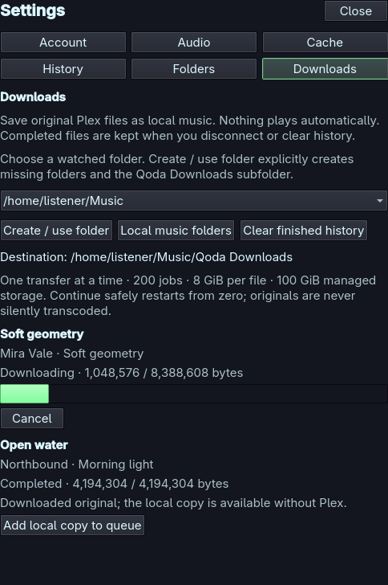
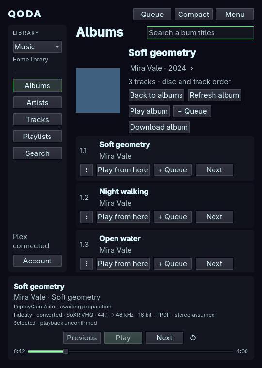

# Plex originals in your local library

Downloads save original Plex music files into a watched local folder. They run
in the backend while the interface is hidden or restarted and never start
playback. A completed copy is ordinary local music: it remains usable without
Plex, including in a mixed local/Plex queue.

## Choose a destination

1. Open **Menu → Downloads**.
2. Choose one of your watched music folders. The first option normally follows
   your [XDG music directory](local-music.md), but no destination is enabled
   until you explicitly choose **Create / use folder**.
3. The button creates missing folders and a private **Qoda Downloads** subfolder.
   Its full destination is shown in the panel. Existing folder permissions are
   not loosened. Choose a folder you own, without write access for other users.

If the list is empty, use **Local music folders** to add and apply a watched
folder first. An explicitly disabled local-library configuration is respected.
Changing a destination pauses unfinished transfers; existing files stay where
they were saved. Reconnect a missing drive or select its destination again before
continuing the corresponding jobs.

## Download and play

In **Tracks**, open a title's **⋮** menu and choose **Download original**, or select
up to 100 tracks and choose **Download selected**. Open an album and choose **Download album** to enqueue every track in disc/track
order in one action. Album admission is atomic: if the album does not fit the
200-job capacity, no subset is started; clear finished history first. Search
results and individual album tracks also offer a download action. These actions require a connected, eligible Plex
source. The server checks permission on the download request; being able to
stream a track does not guarantee download permission.

The Downloads panel shows queued, downloading, paused, completed, failed and
cancelled jobs. Byte progress is indeterminate when the total is unknown.
**Cancel** stops unfinished work. **Retry from zero** / **Continue from zero**
start a fresh original-file transfer: this increment does not append to partial
files or promise HTTP range resume. A changed Plex version requires a new
**Download original** request so the new version is accepted explicitly.

After completion, the local watcher refreshes the library. Choose the corresponding
**Local files** library, or use **Add local copy to queue** in Downloads. A track's
menu also offers that action when a verified retained copy exists. The action
adds an independent local occurrence, preserving the verified local version;
it does not replace existing Plex occurrences or start playback. Local-copy
playback does not send Plex timeline reports.

Original bytes and embedded tags, including ReplayGain, stay unchanged. A safe
original filename suffix is preserved, falling back to the part URL or container. The
selection uses the first Plex media representation, matching the existing
original playback selection, and requires exactly one part. Multipart items
are explicitly unsupported. There is no automatic transcode or representation
switch on failure. Missing tags use the local provider's filename/folder
fallbacks. Embedded JPEG/PNG pictures and conventional folder covers are available
through the local artwork provider. If Plex supplies its cover separately, Qoda
saves a bounded `<audio filename>.qoda-cover.jpg` sidecar beside the original.
Audio bytes and checksums stay unchanged. These covers work offline and remain
when caches/sign-in are cleared. Artwork failure does not discard a downloaded
original; a sidecar write failure appears in its job message.

For older downloads with missing covers, choose **Download album** again (or
**Download original** for a track). Verified existing originals are reused and
missing cover sidecars are added without transferring the audio again. Existing
images are never overwritten. Local covers are read afresh rather than borrowing
the remote artwork cache's freshness, so restored covers become visible after
a local rescan/reopening the album.

## Storage and interruptions

The initial limits are one active transfer, 200 retained jobs, 100 selected tracks or one album per
request, 8 GiB per file, 2,000 import records and 100 GiB of registered originals.
Available filesystem space is checked as well; failed writes remain visible.
The budget does not cause automatic music deletion. Clear finished history to
make room for more jobs; provenance records remain for duplicate detection.
Unresolved publication records are retained and count toward storage limits until
Retry or restart verifies the copy. The panel explains retained history; restoring
a missing destination may be required before verification.

Only completed files appear in the library. Private incomplete files use the
reserved `.qoda-download-staging` directory inside **Qoda Downloads**; the watcher
excludes this name. Publication is atomic and never overwrites an existing file.
Names include a safe title and source/version identity. Repeated requests reuse
a verified existing import. New versions or collisions create a separate copy.
Missing or modified copies are labelled unavailable instead of being silently
replaced. Browse local music to explicitly select externally modified content.

Quit, account changes and destination changes cancel network work and leave
unfinished jobs paused. After restart, continuation is explicit. A journaled
publication is recovered only when the final file's identity and checksum prove
that it belongs to the interrupted import. No automatic retry starts at launch.

**Disconnect**, **Sign out & forget**, cache clearing, **Clear finished history**
and removing a watched folder never delete completed downloads. Cancellation
cleans only verified app-owned incomplete files. Deleting finished music is not
a download-manager operation. Moving/removing completed files manually can make
their recorded copies unavailable; clearing history does not reset the import
or storage budget.

The private version-1 journal is
`$XDG_STATE_HOME/qoda/downloads-v1/state.json` (normally
`~/.local/state/qoda/downloads-v1/state.json`). It holds job state, source/version
identities, checksums and local provenance, without tokens or authenticated URLs.
Damaged, oversized or newer journals are preserved and disable Downloads while
ordinary playback remains available. Use a compatible build or restore your
own backup; the application does not erase unsupported data to recover.

## Implementation and evidence

The provider uses original part requests with `download=1`; the
[Plex Media Server API](https://developer.plex.tv/pms/) documents this download flag
and its permission-denied response. Metadata plus the permission-checked HEAD
response pin the representation, available ETag and length. GET must remain
consistent; requests do not follow redirects or fall back to ordinary streaming
when download permission is refused. Missing validators never enable partial
append. Downloading does not call the playback reporting interface.

Synthetic HTTP/provider, filesystem and native null-output tests cover the
supported pipeline; fictional English/German layouts cover controls and command
fences. This is not a claim of certification for every shared/restricted Plex
account or server version. Existing [audio qualification limits](first-release-scope-proposal.md)
apply equally to downloaded music.
