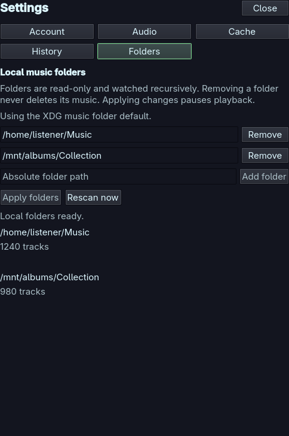

# Local music folders

Local folders are a read-only music provider alongside Plex. No Plex sign-in or
server is needed. Choose **Menu → Local music folders** to edit the folders,
then choose the corresponding **Local files** library in the library picker.
Tracks, albums, artists, search, queue controls and playback use the same player.
Local saved playlists and local cover extraction are not provided yet.

## Configure folders

Qoda initially uses `XDG_MUSIC_DIR` from
`$XDG_CONFIG_HOME/user-dirs.dirs` (normally `~/.config/user-dirs.dirs`). This is the
[freedesktop XDG user directories convention](https://wiki.freedesktop.org/www/Software/xdg-user-dirs/),
including localized folder names. Without an entry, the default is `~/Music`.
Setting the XDG music directory to your home directory disables the implicit
scan. Qoda reads this file as data and never executes it.

Enter an absolute folder path, choose **Add folder**, and then **Apply folders**.
You can edit existing paths or remove rows before applying. Changes pause
playback and revoke prepared media; use Play/Resume explicitly afterward.
Removing every folder disables local libraries, including the default. Removing
a folder does **not** delete, rename or modify any music. Queue entries retain
their identities and may be unavailable until their folder is added again.

Up to 16 nonoverlapping folders can be configured. Duplicate folders and folders
inside another configured folder are rejected. Existing roots are resolved to
canonical paths; symlinks below them are skipped. Missing/removable folders stay
configured and are retried. Check each folder's status/count for missing drives,
permissions or scan limits. **Rescan now** also retries unchanged metadata.

Private, versioned preferences live in
`$XDG_CONFIG_HOME/qoda/local-folders.json`. An explicitly saved empty list takes
precedence over the XDG default. Invalid, oversized or newer settings are
preserved and reported rather than overwritten. Plex disconnect/sign-out keeps
these folder preferences, although the existing account cleanup still stops
playback and clears the shared listening session.

## Watching and formats

Recursive polling checks for additions, modifications and removals every five
seconds, after the previous scan finishes. Changed metadata is published as one
snapshot. Unchanged file fingerprints reuse both successful and rejected probes;
the index is rebuilt on startup. A first scan of a large collection can take time.

FFmpeg's `ffprobe` supplies embedded title, artist, album, album artist, year,
duration and disc/track numbers. Filenames and parent-folder names provide
fallback titles/albums. Metadata remains in its original language. Files with
unusual extensions are included when probing identifies audio. Recognized audio
extensions can still be offered with filename metadata when probing fails;
libmpv is the final decoder authority. A decoder error remains visible. Plex
server transcoding is only available for Plex tracks, never for local files.
Install Arch's `ffmpeg` package if probing is unavailable; the pacman package
declares it as a runtime dependency.

Each scan is bounded to 100,000 regular files, 300,000 visited entries and 64
subfolder levels across the configured roots. At most four metadata probes run
at once, with a four-second deadline and 64 KiB metadata output limit per file.
Probes can read only the supplied file descriptor, without network/external file
references. Symlinks below a root, FIFOs, devices and other special files are
excluded. Scan-limit messages mean the library is incomplete: choose narrower
roots. Album details retain the player's 500-track snapshot limit.

## Plex downloads

[Download original Plex tracks](downloads.md) into a chosen watched folder via
Menu → Downloads. The explicit import service writes completed files; the local
provider stays read-only. The reserved `.qoda-download-staging` directory is
excluded from scans so incomplete transfers cannot appear as music. Completed
copies survive Plex sign-out and are played as local tracks.

## Playback and changed files

Local playback uses revocable loopback grants with range/HEAD support, followed
by the existing libmpv, ReplayGain, gapless and selected output pipeline. Qoda does
not expose raw music-file URLs to the decoder or track models. Physical-output
and gapless qualification limits remain those of the
[audio support boundary](first-release-scope-proposal.md).

Track identities depend on the root and relative path. Renaming or moving a file
changes its identity. Prepared versions include file identity, size and change
timestamps. Replacing an already queued file does not silently substitute new
content: reselect it from the refreshed library to accept the new version. A
removed or unreadable file is unavailable; reconnect its drive, rescan and retry.
