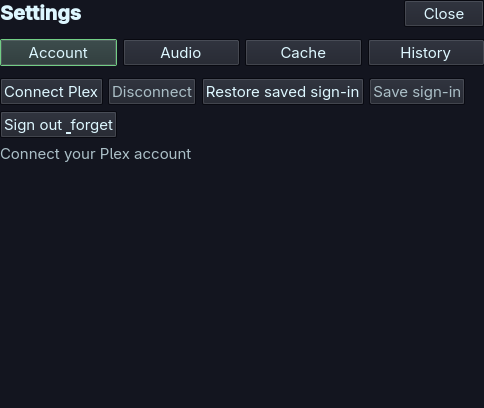
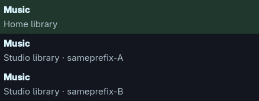
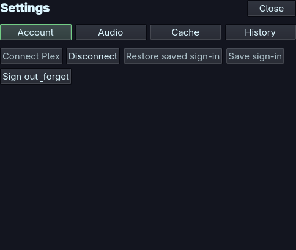
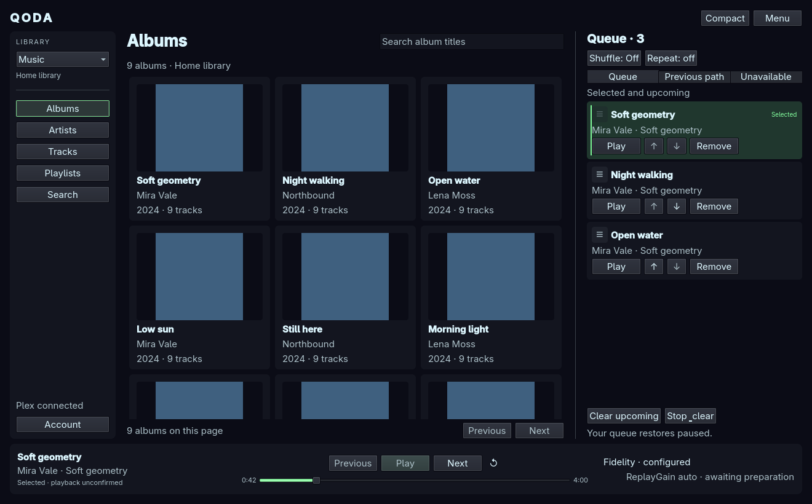
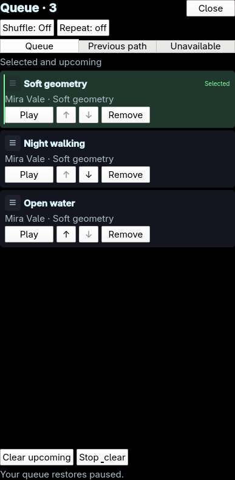
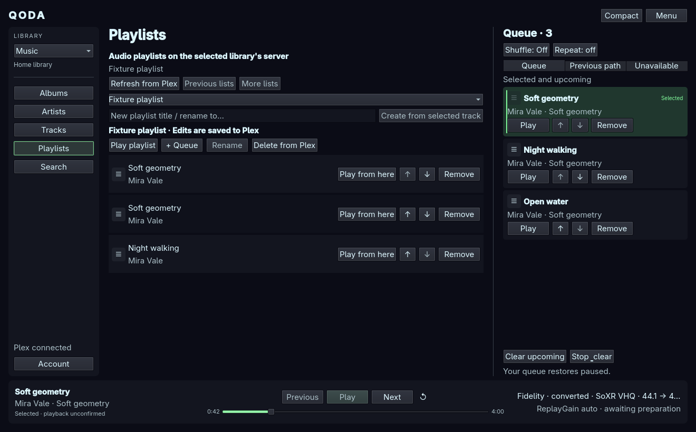
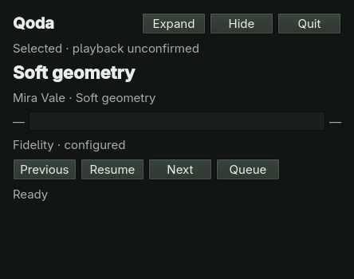
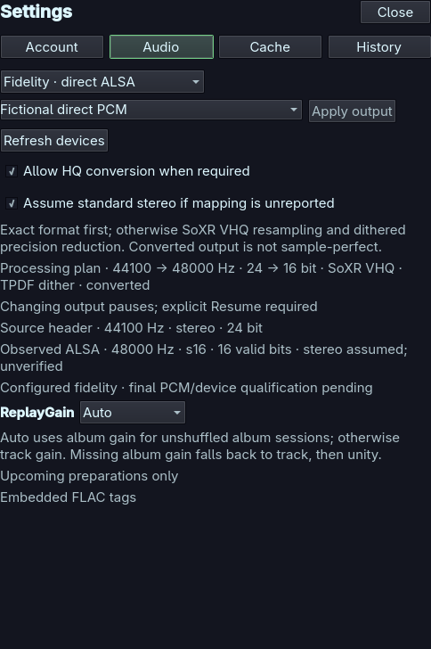
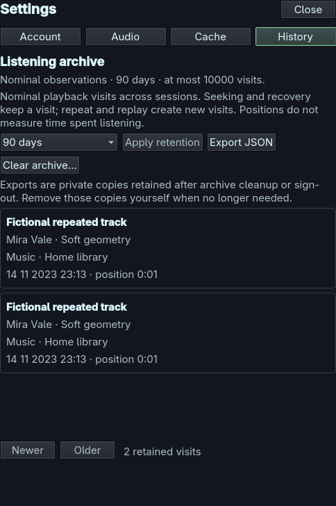
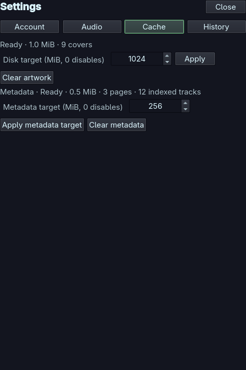

# Qoda Player user guide

Qoda is a music player for an Arch/Omarchy Wayland desktop. It browses your Plex
music libraries and keeps its playback queue locally. Opening the player or
restoring a saved session does not start music: choose **Play** or **Resume**.

All screenshots below show fictional music and accounts. The compact image uses
the production compact controls on a neutral background; its placement is chosen
by your desktop. Colors follow your Omarchy theme when available.

## Contents

- [Install, update and remove](#install-update-and-remove)
- [Connect Plex](#connect-plex)
- [Browse and search](#browse-and-search)
- [Play music and manage the queue](#play-music-and-manage-the-queue)
- [Manage Plex playlists](#manage-plex-playlists)
- [Full, compact and hidden player](#full-compact-and-hidden-player)
- [Audio output and ReplayGain](#audio-output-and-replaygain)
- [History, saved sessions and cache](#history-saved-sessions-and-cache)
- [Troubleshooting](#troubleshooting)

## Install, update and remove

### Install the Arch package

1. Update your Arch system normally with `sudo pacman -Syu`.
2. Open the repository's [Actions](https://github.com/42lizard/qoda-player/actions)
   page. Choose a successful **main** run of **Rust and QML checks**. Its
   **Artifacts** section contains `qoda-player-arch-x86_64-<commit>`.
   Download it (GitHub may ask you to sign in), then extract the ZIP.
3. In the extracted directory, verify the checksum and install the package:

   ```sh
   sha256sum -c SHA256SUMS
   sudo pacman -U ./qoda-player-*.pkg.tar.zst
   systemctl --user daemon-reload
   /usr/bin/qoda show
   ```

Pacman installs the runtime dependencies, including Quickshell, Qt, mpv and the
icon font. You do not need Rust, Cargo or a checkout to run the package.
`COMMIT` records its source revision. Artifacts are retained for 30 days; main
pushes, pull requests and manual workflow runs build packages after checks pass.
Pull-request artifacts are development builds; use main for ordinary installation.
This is a downloadable package, not an AUR entry or a configured pacman repository.

For **Save sign-in**, install `libsecret` and have an unlocked Secret Service
keyring in your desktop session. Without it, you can connect for the current
session. Installation never enables autostart, launches playback or changes your
Omarchy configuration. Direct output and installed-service behavior retain the
[documented support limits](first-release-scope-proposal.md).

### Existing source/development installations

Quit the development player before launching the package. The package refuses
to adopt another backend on the shared Qoda socket. Source and packaged players
use the same user profile: operate one installation at a time.

A source-installed `~/.local/bin/qoda` or desktop entry may take precedence over
`/usr/bin/qoda`. Use `/usr/bin/qoda` explicitly until you remove the old source
installation using its [source installer](installation.md). Keep the same prefix
and config-home when removing it. Do not delete your Qoda data directories.
The pacman units are named `qoda-packaged-backend.service` and
`qoda-packaged-ui.service`; the source units have different names.

### Update

Quit packaged Qoda in **every logged-in user session** before an upgrade. Its
pacman transaction guard refuses upgrades/removal while a packaged process is
running. For the current user:

```sh
/usr/bin/qoda quit
sudo pacman -U ./qoda-player-NEW-VERSION-x86_64.pkg.tar.zst
systemctl --user daemon-reload
/usr/bin/qoda show
```

The last line reopens paused. Preferences, sign-in, queue/history databases and
cache remain in your user profile. Package updates replace code, not that data.
Downgrading code does not downgrade databases: startup refuses unsupported data
formats. Keep backups and use a compatible build; do not delete newer data to
force a downgrade. Source-installer rollback commands are for source installs,
not pacman packages.

### Remove

```sh
/usr/bin/qoda quit
sudo pacman -R qoda-player
systemctl --user daemon-reload
```

Removal retains preferences, queue/history, cache and keyring sign-in. To forget
credentials or clear caches, use the corresponding player controls before removal.
Removing the application does not delete Plex music.

## Connect Plex

1. Open **Menu → Account** and choose **Connect Plex**.
2. Choose **Open Plex sign-in** to open the displayed browser sign-in link and approve Qoda in Plex. The button uses Brave; with another browser, open the displayed URL manually.
   Complete browser sign-in yourself; do not paste your password into Qoda.
3. Return to Qoda and wait for connection/discovery. Select a music library in
   the library picker. Server labels distinguish similarly named libraries.
4. Choose **Save sign-in** if you want to keep the credential in your keyring.
   On a later launch use **Restore saved sign-in** to reconnect.





**Disconnect** stops playback and removes Qoda's cached metadata/artwork, saved
session and listening archive, while keeping the saved sign-in. **Sign out &
forget** also removes Qoda's sign-in, saved queue and session backups; general
preferences remain. Export listening history you want to keep before either
cleanup. These actions do not delete Plex music or saved Plex playlists.
Review the Account panel's status to see whether a sign-in is saved, absent or
unavailable. If the keyring is locked, unlock it through your desktop and retry
the explicit action. A successful local forget/disconnect is not a promise that
every Plex server immediately rejects an already issued credential.



The qualified Plex path is an owned server using browser-PIN authorization.
Shared/restricted accounts and every server version have not been certified;
see the [Plex support matrix](plex-support-matrix.md) for exact boundaries.

## Browse and search



Choose **Albums**, **Artists**, **Tracks** or **Playlists** in the browser.
Opening an album shows its ordered tracks; an artist leads to their albums.
Artwork is optional. Loading details does not play anything.

Use the current browser's search field to filter its supported title/name scope.
Use **Search** (or **Ctrl+K**) for cross-library track search. Results keep their
server/library identity. Partial or cached results show their status: reconnect
or refresh before expecting offline entries to be playable. Paging and result
limits mean the displayed page is not necessarily the entire library.

In Tracks, use checkboxes, **Ctrl-click** and **Shift-click** for selection, then:

- **Play** creates a local playback queue from the chosen tracks and starts it.
- **Play next** adds them after the current occurrence, preserving order.
- **Add to queue** appends them without interrupting playback.

Album and playlist playback also make independent queue copies. Changing the
local queue afterward does not edit the Plex album or saved playlist.

## Play music and manage the queue

Use the bottom transport for Play/Resume, Pause, Previous, Next and seeking.
Seeking is enabled when the player has confirmed playback timing. Changing the
selected item or restoring a session is distinct from confirmed listening;
controls and labels reflect that difference.

The wide layout keeps the queue at the right. In a narrower window open **Queue**
to use the drawer:



You can add the same track repeatedly; each queue occurrence has its own identity.
Move or remove eligible upcoming rows using their controls or drag handles.
The backend confirms changes before the new order appears. A changed queue or
canceled drag can invalidate a pending move; retry against the current rows.

- **Shuffle** keeps a stable shuffled order rather than reshuffling on every tick.
- **Repeat Off / One / All** controls natural completion. Manual Next is a separate action.
- **Previous** restarts the current track after the configured navigation threshold;
  near its start it navigates the confirmed previous path. Use the **Previous path**
  inspector to select an exact earlier occurrence when duplicates are present.
- **Replay** creates another listening visit. **Clear upcoming** preserves current
  playback; **Stop & clear** stops and clears the queue.

If a queued item becomes unavailable, use **Retry**, **Skip & continue** or
**Remove** as offered. Individual unavailable items can be skipped during automatic
progression; server/account-wide failures pause instead of cycling indefinitely.

Editing a future occurrence can require a reset if its samples have already entered
the audio engine. When Qoda asks you to review a buffered transition, inspect the
selection and explicitly choose Resume or Play. It does not claim already buffered
samples were retracted without interruption.

## Manage Plex playlists



To create a playlist:

1. Select a music library and open **Tracks**.
2. Select the track that should be its first entry.
3. Open **Playlists**, enter a name in **New playlist title / rename to…**, and
   choose **Create from selected track**.
4. To add more tracks, keep that editable playlist selected, return to Tracks,
   and use each track row's **+ Playlist** button.

To edit an existing playlist, choose it in **Choose a saved playlist**. Enter a
new title in the same name field and choose **Rename**. Move/remove entries by
their row controls or drag handles. **Delete from Plex** removes the saved
playlist, not its source music files. These changes are saved to Plex; smart
playlists remain read-only.

Provider playlist edits and local queue edits are separate operations. **Play
playlist** copies the current entries into a local playback queue; **+ Queue**
appends a copy. Changing that queue does not edit the saved playlist.

If an edit's outcome is uncertain, **Refresh** before another mutation. Do not
repeat the request blindly: the server may already have applied it. Some Plex
servers collapse saved duplicate tracks. Qoda explains an unconfirmed duplicate
and retains the refresh requirement; use local queue duplicates for repeated plays.

## Full, compact and hidden player

**Hide** closes the visible surface while the backend can keep playing. **Quit**
stops Qoda and checkpoints its session. Closing/hiding a window is not a request
to erase its queue.



For the package, launcher commands work without a checkout:

| Command | Effect |
| --- | --- |
| `qoda show` | Show the full player; launch paused if stopped. |
| `qoda compact` | Show compact controls. |
| `qoda toggle` | Toggle the current surface. |
| `qoda hide` | Hide without starting services. |
| `qoda search` / `qoda queue` | Open the corresponding full-player view. |
| `qoda status` | Report service/last-exit status without starting playback. |
| `qoda quit` | Stop the packaged player and report checkpoint failures. |

Use `/usr/bin/qoda` when another `qoda` command shadows the package.
Your desktop's MPRIS controls can control playback while hidden and raise the UI
when that route is available. The optional Omarchy bar widget provides the music
icon and compact controls; installation is a separate explicit action described
in [bar widget setup](bar-widget.md). For a package-managed launcher use its
installed-prefix mode with `/usr`. It is not enabled by pacman installation.

**Ctrl+K** focuses Search in full/compact views. **Tab/Shift+Tab** move among
controls and **Enter/Space** activate the focused button. Compact controls also
use Space for playback when no editing control consumes it. **Escape** dismisses
menus/drawers, cancels a reorder, or hides compact controls as appropriate.

## Audio output and ReplayGain

Open **Menu → Audio settings**. **Desktop · PipeWire** is the default and allows
normal desktop mixing. **Fidelity · direct ALSA** uses an explicitly selected
hardware device. Select the mode/device and choose **Apply**; applying output
settings pauses playback. Choose Play/Resume explicitly afterward.



Strict Fidelity refuses unsupported source rates/precision. Enable **high-quality
conversion when required** to permit SoXR VHQ conversion and dithered precision
reduction when an exact format cannot be used. The display reports the processing
plan. **Assume standard stereo** is a separate compatibility choice for devices
that do not report channel mapping; the assumed layout remains unverified.

Continuous conversion shares one converter across compatible, verified stereo
16/24-bit WAV/FLAC sources at 44.1, 48 or 96 kHz, with at least two seconds per
source and gapless chaining enabled. Short, unknown, incompatible or resumed
sources use an explicitly labeled independent path. Seeking, recovery and output
changes rebuild the stream. Other modes/codecs do not inherit this qualification.

**ReplayGain** controls track-to-track loudness from supported embedded tags:

| Mode | Behavior |
| --- | --- |
| Off | Unity gain. |
| Track | Prefer track gain. |
| Album | Prefer album gain, falling back to track gain. |
| Auto | Album gain for an eligible unshuffled album session; otherwise track gain. |

Missing/unreadable tags use a visible unity fallback. Clipping prevention can
limit gain. Changes apply to upcoming preparations; they do not rewrite audio
files. Plex loudness fields are not treated as equivalent ReplayGain tags.

Converted output is not sample-perfect. Digital tests do not certify your ALSA
hardware, DAC or analog path; direct-output/device continuity remains experimental.
If a device refuses a source format, enable the explicit HQ fallback or choose
Desktop. See [audio details](audio/hq-conversion.md) for the measured scope.

## History, saved sessions and cache

The queue checkpoints its selection, local position and source/version identity.
After a backend restart it restores paused and needs fresh playback access.
A changed media version or lost permission is shown rather than silently substituted.

**Previous path** is navigation history. **Menu → Listening archive** (History in Settings) is the
persistent history of confirmed nominal observations, with paging, retention,
clearing and private JSON export. Selection or buffering alone is not a listening
record. Exported history contains your listening information; choose its destination
accordingly. Clearing local history does not clear Plex account history.



**Menu → Cache** shows artwork/catalog cache usage, budget controls and clearing.
Cached browsing can remain available when disconnected, with an explicit offline
or stale label. A cached catalog entry is not an offline audio download.



Signing out cleans up account-scoped cached access. Clearing cache does not delete
Plex music or edit saved Plex playlists. If cleanup fails, retry the visible action;
Qoda keeps the failure visible instead of claiming cleanup succeeded.

## Troubleshooting

| Symptom | Action |
| --- | --- |
| Hidden player | Run `/usr/bin/qoda show`, use the music widget, or use desktop Raise when available. |
| Wrong/old launcher opens | Check `command -v qoda`; use `/usr/bin/qoda` and remove the old source installation through its installer. |
| Packaged units overridden | Inspect `systemctl --user cat qoda-packaged-backend qoda-packaged-ui`; resolve your own overrides before retrying. |
| Services have the wrong desktop environment | Follow the launcher's environment mismatch message from your graphical session. Do not launch through a root shell. |
| Saved sign-in unavailable | Unlock your desktop keyring, ensure libsecret/Secret Service are available, then explicitly restore or sign in again. |
| Library/server unreachable | Check Plex reachability, reconnect/refresh and inspect partial-result labels. Cached browsing is not playback access. |
| Interrupted stream | Use the offered retry/recovery action. Recovery is bounded and retains the pinned version/visit; it can end paused. |
| ALSA rate/precision error | Choose Desktop or enable the explicit HQ conversion policy, then Apply and Resume. |
| Save/backup error | Keep the error visible, use Retry save, and inspect diagnostics before replacing a database. |
| Upgrade/removal refused | Quit packaged Qoda in every session; inspect remaining packaged processes rather than forcing replacement. |

For packaged diagnostics:

```sh
/usr/bin/qoda status
journalctl --user -u qoda-packaged-backend -u qoda-packaged-ui --since today
```

Review logs before sharing: remove account/server identifiers, endpoints, track
information and credentials. Never publish keyring values or raw authentication
responses. The [support matrix](plex-support-matrix.md), [source installation
contract](installation.md) and [recovery notes](audio/stream-recovery.md) provide
technical detail when needed. The guide's screenshots can be regenerated with
`python3 tools/capture-user-guide.py` in a development checkout; they do not use
real accounts, media or your compositor.
